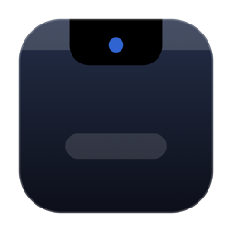
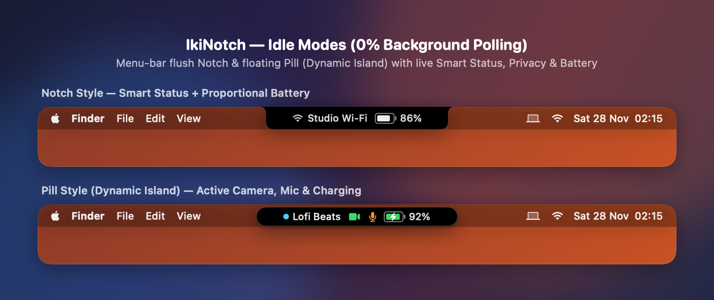
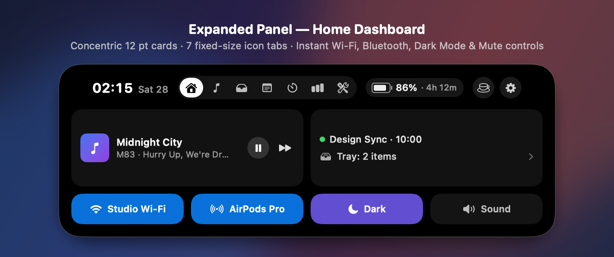
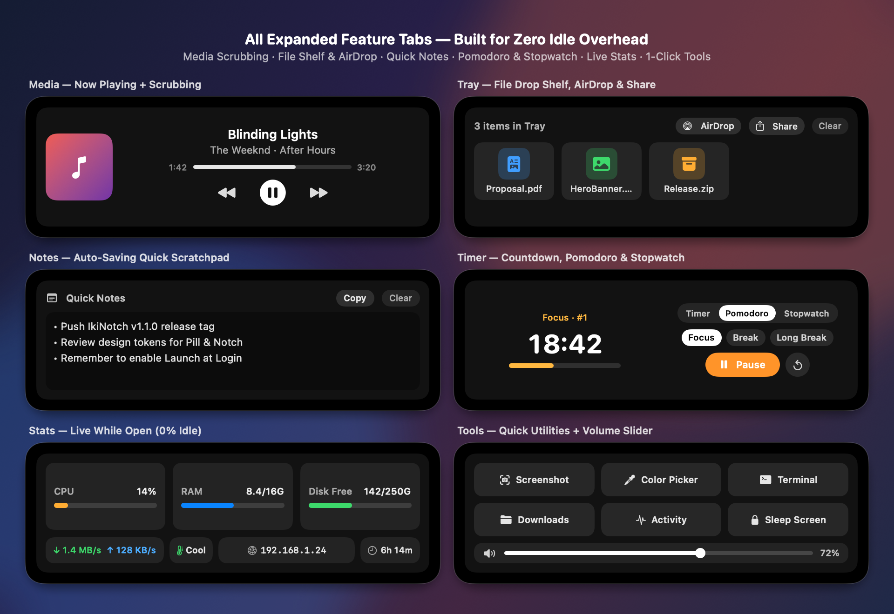

<div align="center">
  
  <h1>IkiNotch</h1>
  <p>A lightweight, native macOS virtual notch &amp; Dynamic Island utility for non-notch Macs built with <strong>Swift, AppKit, and SwiftUI</strong> — engineered for <strong>near-zero idle consumption</strong> (0% background polling when collapsed).</p>

  <p>
    <a href="https://github.com/asyiraafnufail/ikinotch/releases">
      
    </a>
    
    
    
    
    <a href="https://github.com/asyiraafnufail/ikinotch/stargazers">
      
    </a>
  </p>
</div>

## Key Features

- **Notch & Pill (Dynamic Island) Styles** — switch live between a menu-bar flush **Notch** (concave ears) and a floating **Pill** capsule; auto-hides in **Fullscreen Spaces**, supports **Multi-Monitor** (*Main Display* or *Follow Active Display*), optional hidden Menu Bar icon (with right-click context menu on the notch), and a zero-CPU customizable **Global Shortcut** (`⌃⌥N`, `⌥Space`, `⌃⌥Space`, `⌘⇧N`).
- **3 Zero-Timer Idle Modes**:
  - **Smart Status** — automatically displays Active Timer → Now Playing (Browser YouTube, Spotify, Apple Music, VLC) → Calendar Up Next → Connected Wi-Fi (SSID or icon-only) → `Offline` + proportional real-level Battery (`Icon & %`, `% Only`, or `Icon Only`).
  - **Custom** — custom text (+ optional battery).
  - **Pure Black** — solid black MacBook-style notch.
- **Event-Driven Indicators** — subtle **Camera (green)**, **Microphone (orange)**, **Caps Lock (`⇪`)**, and **Keep Awake (`☕`)** icons appear automatically when active (0% polling).
- **Expanded Panel (`Home` · `Media` · `Tray` · `Notes` · `Timer` · `Stats` · `Tools`)**:
  - **Home:** Combined dashboard (Mini Media, Calendar & Tray summary, plus 4 Quick Controls: **Wi-Fi**, **Bluetooth**, **Dark/Light Theme**, **Mute**).
  - **Media:** Full Now Playing card with cached 128px album art / YouTube thumbnail, interactive **Progress Bar (click/drag to scrub)**, and system-wide `MediaRemote` controls.
  - **Tray:** File Drop Shelf (zero-copy drag-and-drop holding tray, drag out to any app, **AirDrop**, and macOS **Share** sheet).
  - **Notes:** Auto-saving quick scratchpad with one-click Copy & Clear.
  - **Timer:** Multi-mode **Timer** (`1m/5m/10m/25m/45m` + `±1m`), **Pomodoro** (*Focus / Break / Long Break* cycles), and **Stopwatch** (*Mark Lap*) with completion sound, macOS notification, and live idle notch display.
  - **Stats:** Live-while-visible CPU %, RAM, Disk Free, Network Down/Up speed, Thermal state, clickable Local IP, and Uptime (0% CPU when closed).
  - **Tools:** Screenshot (Clipboard), Color Picker (`#HEX`), Terminal, Downloads, Activity Monitor, Sleep Screen, and a compact CoreAudio **Volume Slider**.
  - **Keep Awake (`☕`):** one-click sleep prevention via `IOPMAssertion`.
- **Customizable & Symmetrical:** choose *Trigger Mode* (`Expand on Hover` / `Click Only`), *Animation Style* (`Snappy`, `Smooth`, `Bouncy`, `Instant`), *Hover Delay* (`50 / 100 / 150 / 200 ms`), notch size, and *Launch at Login* (`SMAppService`).

See the full feature breakdown in [FEATURES.md](FEATURES.md).

## Screenshots & Demo

### Video Demo (13s · 720p)
▶ [Watch IkiNotch Demo Video (`docs/demo.mp4`)](docs/demo.mp4)

### Idle Modes — Notch & Pill (Dynamic Island)


### Expanded Panel — Home Dashboard


### Feature Tabs — Media, Tray, Notes, Timer, Stats & Tools


## Zero-Idle Architecture

- **0 polling timers when collapsed** — backed by native OS events (`NSTrackingArea`, `IOPSNotificationCreateRunLoopSource`, `MediaRemote`, `CWEventDelegate`, `EKEventStoreChanged`, `NSEvent.flagsChanged`).
- **Full App Nap support** & dynamic `NSPanel` frame shrinking when collapsed.
- **Zero third-party dependencies** — compact ~2.5 MB `.app` bundle.

## Compatibility & Supported Devices

- **macOS:** **macOS 13.0 (Ventura)** or later (Ventura, Sonoma, Sequoia).
- **Macs (Non-Notch Primary Target):**
  - **Intel (`x86_64`) & Apple Silicon (`M1 / M2 / M3 / M4`):** Packaged as a **Universal Binary** — runs **100% natively** on both Intel and Apple Silicon Macs without Rosetta 2.
  - **External Monitors & Desktop Macs:** Works on any external display (Multi-Monitor *Main Display* or *Follow Active Display*). Desktop Macs without a battery automatically hide battery indicators cleanly.

## Build & Run

Requirements: **macOS 13.0+** and **Xcode 15+ / Swift 5.9+**.

```bash
# Run unit tests
swift test

# Build release binary and package build/IkiNotch.app
./scripts/build_app.sh

# Launch the app
open build/IkiNotch.app
```

For daily use and **Launch at Login**, move `build/IkiNotch.app` into `/Applications`.
